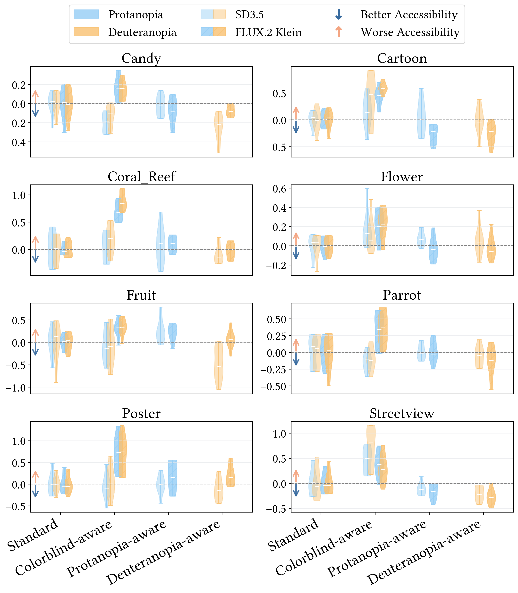
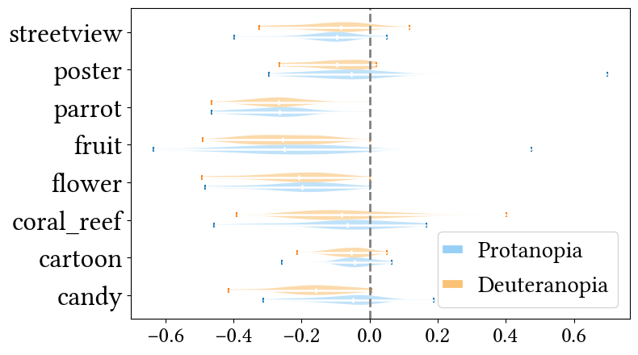

# Prompt-Driven Color Accessibility Evaluation in Diffusion-based Image Generation Models

## People

<table class="" style="margin: 10px auto;">
  <tbody>
    <tr>
      <td></td>
      <td></td>
      <td></td>
    </tr>
    <tr>
      <td><p style="text-align:center;"><a href="mailto:xinyao.zhuang.24@ucl.ac.uk">Xinyao Zhuang</a><sup>1</sup></p></td>
      <td><p style="text-align:center;"><a href="mailto:echevarr@adobe.com">Jose Echevarria</a><sup>2</sup></p></td>
      <td><p style="text-align:center;"><a href="https://kaanaksit.com">Kaan Akşit</a><sup>1</sup></p></td>
    </tr>
  </tbody>
</table>

<p style="text-align:center;">
<sup>1</sup>University College London,
<sup>2</sup>Adobe Research
</p>
<p style="text-align:center;"><b>SIGGRAPH Asia 2026 Poster</b></p>

## Resources

:material-newspaper-variant: [Publication DOI](https://doi.org/10.1145/3829333.3847900)
:material-file-code: [Code](https://github.com/complight/Prompt-Driven_Color_Accessibility_Evaluation_in_Diffusion-based_Image_Generation_Models)

??? info ":material-tag-text: Bibtex"
    ```bibtex
    @inproceedings{zhuang2026prompt,
      author = {Xinyao Zhuang and Jose Echevarria and Kaan Akşit},
      title = {Prompt-Driven Color Accessibility Evaluation in Diffusion-based Image Generation Models},
      booktitle = {SIGGRAPH Asia 2026 Posters},
      year = {2026},
      publisher = {ACM},
      doi = {10.1145/3829333.3847900},
      url = {https://doi.org/10.1145/3829333.3847900}
    }
    ```

## Abstract

Generative image models are increasingly integrated into creative workflows, but the color accessibility of their outputs for people with Color Vision Deficiencies (CVD) remains largely unexplored. We systematically evaluate whether accessibility-oriented text prompts can reduce perceptual-structural degradation under CVD simulation. To support this evaluation, we introduce **CVDLoss**, a gradient-based metric that measures differences between an image and its CVD-simulated counterpart in perceptual color space. Across Stable Diffusion 3.5-large and FLUX.2 Klein 4B, we evaluate eight content categories, four prompt strategies, two red-green CVD types, and 10 generated images per condition.

Our results show that prompt-based accessibility interventions are not reliable or uniformly beneficial. The same prompt can improve the metric for one category while worsening it for another, and deficiency-specific prompts do not consistently improve the corresponding simulated condition. These findings suggest that predictable CVD-aware color control requires more than natural-language prompt conditioning alone.

<figure markdown>
  { width="1000" }
</figure>

## Method

We construct a synthetic evaluation set from eight visually distinct categories: candy, cartoon, coral reef, flower, fruit, parrot, poster, and street view. Each category is rendered with four prompt types: standard, colorblind-aware, protanopia-aware, and deuteranopia-aware. For each model, category, and prompt type, we generate 10 images at $1024 \times 1024$ resolution.

Color-vision deficiencies are simulated using the physiologically based model of Machado et al. at maximum severity. We focus on protanopia and deuteranopia, the two red-green deficiencies used in the main evaluation. CVDLoss compares OKLab HyAB gradient-magnitude maps computed with Scharr operators:

$$
\mathrm{CVDLoss}(I,I_{\mathrm{CVD}})=
\frac{\sum_p\left(G(I)_p-G(I_{\mathrm{CVD}})_p\right)^2}
{N\,\max_p G(I)_p^2}.
$$

The metric is evaluated independently for each generated image and then reported in log scale. Prompt results are normalized by subtracting the mean log-scale CVDLoss of the standard prompt for the same model, category, and CVD type.

## CVD-ViT Validation

To test whether CVDLoss responds to an explicit accessibility-oriented color transformation, we use CVD-ViT to generate protanopia- and deuteranopia-targeted recolorings. These recolored images are used only as an external validation stage; recoloring is not part of the CVDLoss formulation. Mostly negative shifts in the log-scale comparison indicate that the metric detects the expected reduction in gradient discrepancy after recoloring.

<figure markdown>
  { width="820" }
</figure>

## Findings

Figure 1 summarizes the normalized CVDLoss distributions across categories, prompt types, and CVD conditions. Accessibility-oriented prompts show category- and deficiency-dependent behavior rather than a consistent improvement. This pattern is observed for both main text-to-image models, indicating that prompt-only accessibility control is currently difficult to predict. An additional HiDream-O1 experiment in the supplementary material supports the same qualitative conclusion.

The study motivates future generation methods that incorporate CVD simulation, perceptual accessibility objectives, or explicit post-processing instead of relying on textual instructions alone.

## Relevant Research Works

Here are relevant research works from the authors:

- [Colour Vision Deficiencies Simulation and CVDLoss](https://doi.org/10.1145/3829333.3847900)
- [Computational Light Laboratory](https://complightlab.com/)
